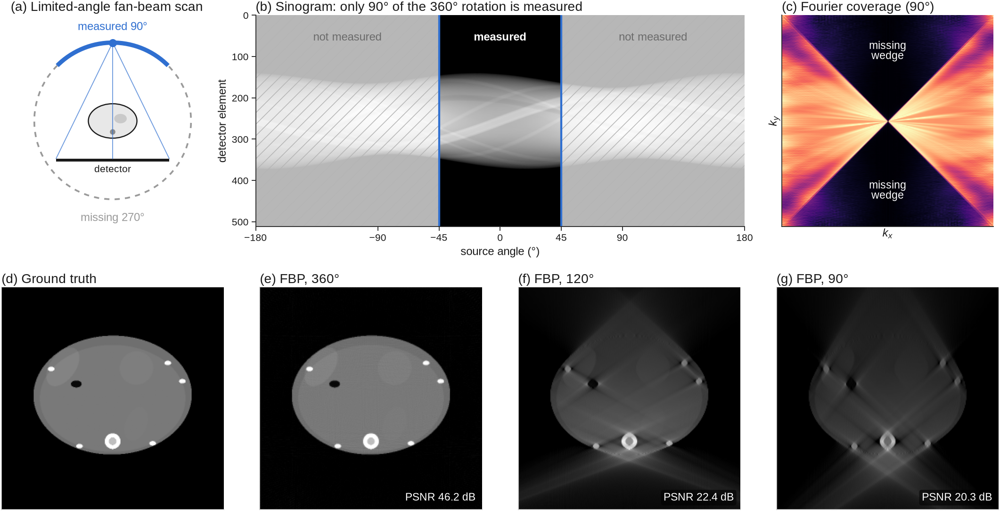
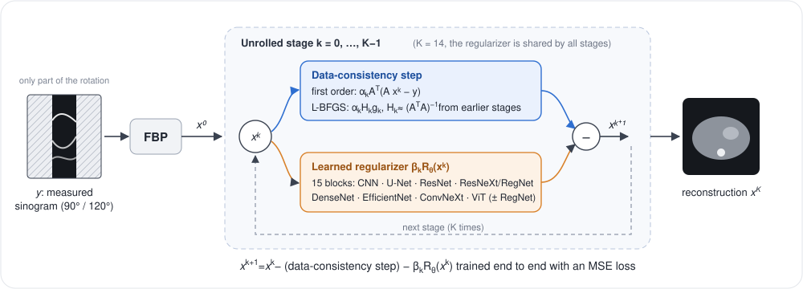
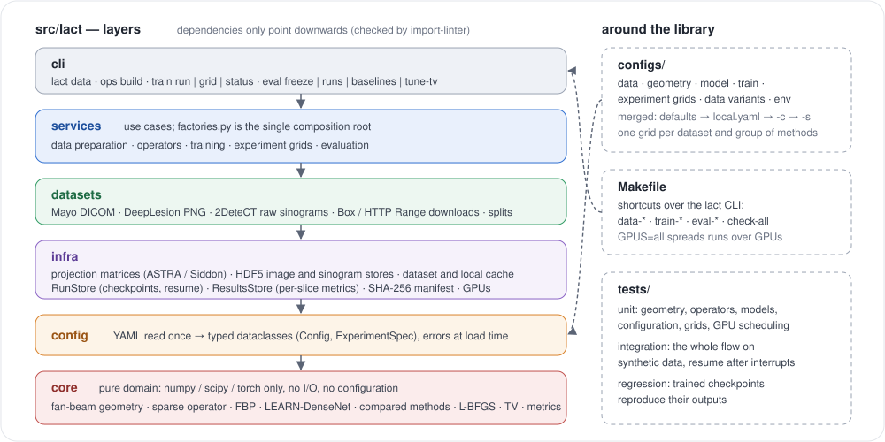

<h1 align="center">LACT: limited-angle CT with LEARN-DenseNet and an L-BFGS data step</h1>

<p align="center">
  Code of the thesis <i>“Đánh giá và so sánh các mạng tích chập sâu trong bài toán CT góc giới hạn”</i><br>
  (Evaluating and comparing deep convolutional networks for limited-angle CT)
</p>

<p align="center">
  
  
  
  
  
</p>

<p align="center">
  
</p>
<p align="center"><sub>
Limited-angle CT on a synthetic phantom. When only 90° or 120° of the rotation is measured, a double wedge of Fourier
space is never observed and filtered back-projection (FBP) produces streaks and lost edges.
</sub></p>

---

## Overview

Limited-angle CT reconstructs a slice from projections covering only part of the rotation, here 90° or 120° of a
fan-beam scan. Edges perpendicular to the missing directions are not measured at all, so better filtering cannot
recover them: the missing information has to come from a learned prior.

This repository contains everything needed to prepare the data, train, and evaluate:

- **LEARN-DenseNet**: LEARN deep unrolling with a DenseNet encoder–decoder as the learned regularizer;
- **an L-BFGS data step**: a quasi-Newton version of the unrolled update that needs no linear solve;
- **compared methods** rebuilt on the same operators: RegFormer, the original LEARN, FBPConvNet, Learned Primal-Dual
  and DPMA, plus the FBP and TV baselines;
- **three datasets**: simulated Mayo/AAPM and DeepLesion sinograms, and measured 2DeteCT sinograms;
- **resumable experiment grids** and a per-slice test evaluation that opens only after the configuration is frozen.

## Method

<p align="center">
  
</p>

Starting from $x^0 = \mathrm{FBP}(y)$, each of the $K = 14$ stages applies a data-consistency step and a learned
regularizer $R_\theta$ shared by all stages:

$$
x^{k+1} = x^k - \alpha_k\, A^\top\!\left(A x^k - y\right) - \beta_k\, R_\theta\!\left(x^k\right)
\qquad\text{(first-order LEARN)}
$$

$$
x^{k+1} = x^k - \alpha_k\, H_k\, g_k - \beta_k\, R_\theta\!\left(x^k\right),
\qquad g_k = A^\top\!\left(A x^k - y\right)
\qquad\text{(L-BFGS data step)}
$$

where $A$ is the sparse fan-beam projector restricted to the measured angles and $H_k \approx (A^\top A)^{-1}$ is built
by the two-loop L-BFGS recursion from the pairs $(x_{i+1} - x_i,\ g_{i+1} - g_i)$ of the earlier stages (memory 13,
Powell damping 0.5). The first stage has no pairs yet and equals the first-order step. The step sizes
$\alpha_k, \beta_k$ are learned per stage and the whole network is trained end to end with an MSE loss.

$R_\theta$ is a 4-level encoder–decoder with 32, 64, 128 and 256 channels, one dense block (3 layers, growth ratio
0.5, GroupNorm) per level, and additive skip connections; it has 2.70M parameters
([`densenet_ed.py`](src/lact/core/models/regularizers/densenet_ed.py), [`learn.py`](src/lact/core/models/unrolled/learn.py)).

### Compared methods

| Method | Type | Configuration |
| --- | --- | --- |
| RegFormer | unrolled, Swin-Transformer + convolution blocks, FBP of the residual, 10 layers | [`regformer.yaml`](configs/model/regformer.yaml) |
| LEARN (original) | unrolled, 3-layer CNN, separate weights per stage, 30 stages | [`learn_orig.yaml`](configs/model/learn_orig.yaml) |
| FBPConvNet | U-Net post-processing of the FBP image | [`fbpconvnet.yaml`](configs/model/fbpconvnet.yaml) |
| Learned Primal-Dual | unrolled primal-dual, 10 iterations | [`lpd.yaml`](configs/model/lpd.yaml) |
| DPMA | dual-domain, two training stages; completes the sinogram to 240° | [`dpma.yaml`](configs/model/dpma.yaml) |
| FBP, TV | classical baselines (TV weight tuned on the validation split) | `lact eval baselines` |

LEARN-DenseNet and RegFormer use one recipe (Adam, cosine schedule, 50 epochs, batch 1, MSE). LEARN, FBPConvNet,
Learned Primal-Dual and DPMA share the recipe that the CG-GLORE paper used for its compared models (AdamW, lr 1e-4 to
1e-5, weight decay 1e-2, 50 epochs; [`bmvc.yaml`](configs/train/bmvc.yaml)). Every run trains from scratch.

## Installation

Python ≥ 3.10 and PyTorch 2.x; a virtual environment inside the project is all that is needed.

```bash
git clone https://github.com/Oxazolidinone/lact-limited-angle-ct.git
cd lact-limited-angle-ct
python3 -m venv .venv && .venv/bin/pip install -r requirements.txt
.venv/bin/pip install -e ".[dev]"          # installs the `lact` command and the development tools
.venv/bin/lact --help
```

The [ASTRA toolbox](https://astra-toolbox.com) builds the projection matrices on Linux GPU machines. Without it (e.g.
on Apple Silicon) the matrices are built by a pure-NumPy Siddon implementation of the same line-intersection model,
which is enough for testing and for the examples below. PyTorch's MPS backend lacks sparse CSR products, so Macs train
on the CPU.

## Quick start (no data needed)

```bash
make test       # unit and integration tests (synthetic data)
make smoke      # the whole flow on synthetic DICOM, a few steps per run, results in outputs_smoke/
```

## Usage

The three steps below run with `make` targets that call the `lact` command; per-machine settings (data folders, cache)
go in `configs/local.yaml`.

### 1. Data

No data are distributed with this repository; each dataset is downloaded from its official source and converted into
an HDF5 image store, projection matrices and simulated (or measured) sinograms.

| Dataset | Content | Download |
| --- | --- | --- |
| [Mayo/AAPM Low Dose CT Grand Challenge 2016](https://www.aapm.org/grandchallenge/lowdosect/) | 10 patients, full dose, 3 mm, split 7/1/2 by patient | `lact data download-mayo` |
| [NIH DeepLesion](https://nihcc.app.box.com/v/DeepLesion) | 2,000 / 200 / 300 key slices from the official split | `lact data download-deeplesion --key-slices` |
| 2DeteCT (Kiss et al., *Sci. Data* 2023) | measured fan-beam sinograms, split by sample as in LION | `lact data download-2detect` |

```bash
make data-joint     # Mayo + DeepLesion in one store: download, preprocess, matrices, sinograms, TV tuning
make data-detect    # 2DeteCT: download, preprocess, matrices, sinograms, TV tuning
```

Simulated geometry: flat-detector fan beam, source–centre 600 mm, centre–detector 290 mm, 512 × 1.875 mm detector,
400 mm field of view, 0.25° angular step; images of 256 × 256 reconstructed from sinograms simulated at 512 × 512.

### 2. Training

Each grid in [`configs/experiment/`](configs/experiment) trains a group of methods on one dataset at 90° and 120°:

| Grid (`_mayo`, `_dl`, `_dt`) | Runs |
| --- | --- |
| `base_*` | LEARN-DenseNet with the first-order step, and RegFormer (2DeteCT: RegFormer only) |
| `lbfgs_*` | LEARN-DenseNet with the L-BFGS data step, same recipe as `base_*` |
| `cmp_*` | LEARN (original), FBPConvNet, Learned Primal-Dual |
| `dpma1_*`, then `dpma_*` | DPMA stage 1, then stage 2 starting from the stage-1 run |

```bash
make train-joint                  # every grid on Mayo and DeepLesion; run again to resume after an interruption
make train-detect GPUS=all        # 2DeteCT, one run per GPU on every visible GPU
lact train status                 # progress of every run
```

A single run, e.g. LEARN-DenseNet with the L-BFGS step on Mayo at 90°:

```bash
lact train run -c configs/variant/joint.yaml configs/data/split_joint_mayo.yaml -m learn_densenet -g fan_a90 \
    -s model.update=lbfgs model.lbfgs_damping=0.5 train.lr=3e-4 exp=dev
```

Each run stores its merged configuration, environment, per-step and per-epoch logs and a summary. An interrupted run
resumes at the exact batch; the training data and matrices are checked against SHA-256 manifests first.

### 3. Evaluation

```bash
make eval-joint     # freeze the configuration, then test every trained run and the FBP/TV baselines
make eval-detect
```

The test split opens only after `lact eval freeze` has recorded the configuration. Each run, split and geometry gets
one CSV of per-slice metrics (PSNR, SSIM, RMSE, RMSE in HU, and the same inside the body mask) in
`<outputs>/eval/per_slice/`, indexed by metadata in `<outputs>/eval/index.json`. `lact eval recheck` re-evaluates the
validation split of finished runs and compares it with the value recorded during training.

## Command-line interface

```
lact data     download-mayo | download-deeplesion | split-deeplesion | download-2detect | split-2detect |
              inspect | preprocess | simulate | stage | fake
lact ops      build
lact train    run | grid | status
lact eval     freeze | runs | baselines | tune-tv | recheck
```

Every command accepts `-c/--config` (extra YAML files), `-s/--set key=value` (overrides) and `--device`. YAML is read
once and converted into typed dataclasses, so a misspelt key or a wrong type fails at load time, not mid-training.

## Repository layout

<p align="center">
  
</p>

```
configs/        YAML: data, geometry, model, train, experiment grids, data variants, environments
src/lact/       the library and the `lact` command
tests/          unit · integration (synthetic data) · regression (finished runs)
docs/           architecture and figures
```

Details and the rules for adding a model or a dataset: [docs/ARCHITECTURE.md](docs/ARCHITECTURE.md).

## Quality checks

```bash
make check-all          # ruff (with pydocstyle) + mypy + import-linter contracts + tests
make test-regression    # finished runs reproduce their outputs; needs LACT_RESULTS_DIR (skipped otherwise)
```

## Notes

- The CG-GLORE re-implementation used in the thesis comparison is **not** included: its authors have not released their
  code. Its training recipe is kept, since the compared methods use it.
- Results of the thesis will be added after it is published.

## Acknowledgements

The data come from the AAPM/Mayo Clinic Low Dose CT Grand Challenge (McCollough et al., *Med. Phys.* 2017), NIH
DeepLesion (Yan et al., *J. Med. Imaging* 2018) and 2DeteCT (Kiss et al., *Sci. Data* 2023); please follow their terms
of use and cite them. LEARN follows Chen et al., *IEEE TMI* 2018; the projection matrices use the ASTRA toolbox when it
is available.
