<h1 align="center">LACT: limited-angle CT reconstruction with deep unrolling</h1>

<p align="center">
  Code of the thesis <i>“Đánh giá và so sánh các mạng tích chập sâu trong bài toán CT góc giới hạn”</i><br>
  (Evaluating and comparing deep convolutional networks for limited-angle CT)
</p>

<p align="center">
  
  
  
  
  
</p>

<p align="center">
  
</p>
<p align="center"><sub>
Limited-angle CT on a synthetic phantom. When only 90° or 120° of the rotation is measured, a double wedge of Fourier
space is never observed and filtered back-projection (FBP) produces streaks and lost edges. Generated by
<code>experiments/figures/make_readme_figures.py</code>.
</sub></p>

---

## Overview

Limited-angle CT reconstructs a slice from projections covering only part of the rotation (here 90°, 120° or 150° of a
fan-beam scan). Edges perpendicular to the missing directions are not measured at all, so the problem cannot be solved
by better filtering alone: the missing information has to come from a learned prior.

This repository benchmarks learned priors inside one fixed **LEARN deep-unrolling** framework, so that the only thing
that changes between methods is the regularization block:

- **15 regularization blocks**: the original LEARN-CNN and seven families (U-Net, ResNet, ResNeXt/RegNet, DenseNet,
  EfficientNet, ConvNeXt, ViT), each with a uniform layout and a RegNetY-200MF layout;
- **a second-order data step**: an L-BFGS variant of the unrolled update that needs no linear solve;
- **compared methods** rebuilt on the same operators: RegFormer, original LEARN, FBPConvNet, Learned Primal-Dual, DPMA;
- **three datasets**: simulated Mayo/AAPM and DeepLesion sinograms, and measured 2DeteCT sinograms;
- **a reproducible pipeline** (`lact pipeline run`) that resumes after interruptions and checks every input by SHA-256.

## Method

<p align="center">
  
</p>

Starting from $x^0 = \mathrm{FBP}(y)$, each of the $K = 14$ stages applies a data-consistency step and a learned
regularizer $R_\theta$ shared by all stages:

$$
x^{k+1} = x^k - \alpha_k\, A^\top\!\left(A x^k - y\right) - \beta_k\, R_\theta\!\left(x^k\right)
\qquad\text{(first-order LEARN)}
$$

$$
x^{k+1} = x^k - \alpha_k\, H_k\, g_k - \beta_k\, R_\theta\!\left(x^k\right),
\qquad g_k = A^\top\!\left(A x^k - y\right)
\qquad\text{(L-BFGS data step)}
$$

where $A$ is the sparse fan-beam projector restricted to the measured angles and $H_k \approx (A^\top A)^{-1}$ is built
by the two-loop L-BFGS recursion from the pairs $(x_{i+1} - x_i,\ g_{i+1} - g_i)$ of the earlier stages, with Powell
damping. The step sizes $\alpha_k, \beta_k$ are learned per stage and the whole network is trained end to end with an MSE
loss.

| Family (block type) | Uniform layout | RegNetY-200MF layout |
| --- | --- | --- |
| 3-layer CNN of the original LEARN | `learn_cnn` 0.06M | – |
| U-Net (plain VGG-style convolutions) | `learn_unet` 2.32M | `learn_unet_regnet` 2.32M |
| ResNet (BasicBlock) | `learn_resnet` 4.09M | `learn_resnet_regnet` 4.23M |
| X block (grouped-convolution bottleneck) | `learn_resnext` 2.95M | `learn_regnet` 3.14M |
| DenseNet (dense block) | `learn_densenet` 2.70M | `learn_densenet_regnet` 2.88M |
| EfficientNet (MBConv + SE) | `learn_efficientnet` 2.51M | `learn_efficientnet_regnet` 2.49M |
| ConvNeXt | `learn_convnext` 1.98M | `learn_convnext_regnet` 2.06M |
| ViT | `learn_vit` 3.67M | `learn_vit_regnet` 3.51M |

All blocks share the same 4-level encoder–decoder. The RegNet layout keeps each family's block and takes the channel
and depth of each level from the RegNetY-200MF rule (w = [24, 56, 152, 368], d = [1, 1, 4, 7], SE ratio 0.25), with
widths scaled to keep the parameter count close to the uniform version.

## Installation

Python ≥ 3.10 and PyTorch 2.x; a virtual environment inside the project is all that is needed.

```bash
git clone https://github.com/Oxazolidinone/lact-limited-angle-ct.git
cd lact-limited-angle-ct
python3 -m venv .venv && .venv/bin/pip install -r requirements.txt
.venv/bin/pip install -e ".[dev]"          # installs the `lact` command and the development tools
.venv/bin/lact --help
```

The [ASTRA toolbox](https://astra-toolbox.com) builds the projection matrices on Linux GPU machines. Without it (e.g. on
Apple Silicon) the matrices are built by a pure-NumPy Siddon implementation of the same line-intersection model, which is enough for
testing and for the examples below. PyTorch's MPS backend lacks sparse CSR products, so Macs train on the CPU.

## Quick start (no data needed)

```bash
make smoke      # synthetic DICOM -> the whole pipeline at a small size, results in outputs_smoke/
make test       # unit and integration tests (synthetic data)
```

A single training run on real data, once the data are prepared (see below):

```bash
lact train run -m learn_densenet -g fan_a90 -s model.update=lbfgs model.lbfgs_damping=0.5 train.lr=3e-4 exp=dev seed=0
```

## Data

No data are distributed with this repository; each dataset is downloaded from its official source by a `lact`
command and converted into an HDF5 image store, projection matrices and simulated (or measured) sinograms.

| Dataset | Content | Command |
| --- | --- | --- |
| [Mayo/AAPM Low Dose CT Grand Challenge 2016](https://www.aapm.org/grandchallenge/lowdosect/) | 10 patients, full dose, 3 mm, split 7/1/2 by patient | `lact data download-mayo` |
| [NIH DeepLesion](https://nihcc.app.box.com/v/DeepLesion) | 2,000 / 200 / 300 key slices from the official split | `lact data download-deeplesion --key-slices` |
| 2DeteCT (Kiss et al., *Sci. Data* 2023) | measured fan-beam sinograms, split by sample as in LION | `lact data download-2detect` |

Simulated geometry: flat-detector fan beam, source–centre 600 mm, centre–detector 290 mm, 512 × 1.875 mm detector,
400 mm field of view, 0.25° angular step; images of 256 × 256 reconstructed from sinograms simulated at 512 × 512.

## Experiments

```mermaid
flowchart LR
    P[DICOM → images.h5] --> A[projection matrices A]
    A --> E0[E0: operator checks]
    E0 --> S[sinograms 90° / 120° / 150°]
    S --> E1[E1: angular sampling, TV tuning]
    E1 --> E2[E2: learning-rate sweep]
    E2 --> F[freeze the configuration]
    F --> E3[E3–E5: training]
    E3 --> T[test evaluation, E6]
    T --> R[tables, figures, analyses]
```



| Step | Question |
| --- | --- |
| E0 | Is the operator correct? (adjoint, gradients, FBP of a phantom) |
| E1 | Is a 0.25° angular step fine enough? |
| E2 | Which learning rate does each of the 15 blocks need? |
| E3 | How do the 15 blocks compare at 90° and 120°? |
| E4 | Does the ranking hold when every block has ~2M parameters? |
| E5 | What changes with a 150° scan? |
| E6 | How does a model trained at one scan range do at another? |
| Phase 2 | A second dataset, the L-BFGS data step, published methods and measured data |

```bash
lact pipeline run --device cuda           # every step in order; run it again to resume after an interruption
lact pipeline status
```

The test split opens only after the configuration is frozen (`lact eval freeze`), and every number in the reports is
read from `outputs/tables/*.csv`. Design and commands of phase 2: [docs/PHASE2.md](docs/PHASE2.md).

## Command-line interface

```
lact data     download-mayo | download-deeplesion | split-deeplesion | download-2detect | split-2detect |
              inspect | preprocess | simulate | stage | fake
lact ops      build | check | density
lact train    run | grid | pilot | plan | status
lact pipeline run | status
lact eval     freeze | runs | baselines | cross | tune-tv | recheck | cg-check | cost
lact report   select-lr | tables | figures | analysis | phase2
lact demo
```

Every command accepts `-c/--config` (extra YAML files), `-s/--set key=value` (overrides) and `--device`. YAML is read
once and converted into typed dataclasses, so a misspelt key or a wrong type fails at load time, not mid-training.

## Repository layout

<p align="center">
  
</p>

```
configs/        YAML: data, geometry, model, train, experiment grids, data variants, environments
src/lact/       the library and the `lact` command
experiments/    thesis analyses, figures and paper numbers built on top of lact
scripts/        operations on rented GPU machines and the school server
tests/          unit · integration (synthetic data) · regression (finished runs)
docs/           architecture, pipeline, phase 2, running on Vast.ai and on a server
```

Details and the rules for adding a model, a dataset or a table: [docs/ARCHITECTURE.md](docs/ARCHITECTURE.md).

## Quality and reproducibility

```bash
make check-all          # ruff (with pydocstyle) + mypy + import-linter contracts + tests
make test-regression    # finished runs: checkpoints reproduce their outputs, tables regenerate identically
```

- Each run stores its merged configuration, environment, code version, per-step and per-epoch logs and a summary;
  interrupted runs resume at the exact batch, with fallback checkpoints and GPU out-of-memory handling.
- Data and matrices are verified against SHA-256 manifests before training; evaluation results are indexed by metadata.
- Every compared run uses the same GPU type and arithmetic mode as its baseline.

## Documentation

| Document | Content |
| --- | --- |
| [ARCHITECTURE.md](docs/ARCHITECTURE.md) | layers, main flows, where new code goes |
| [PIPELINE.md](docs/PIPELINE.md) | the E0–E6 pipeline, parallel runs, failure handling |
| [PHASE2.md](docs/PHASE2.md) | two datasets, L-BFGS data step, comparison, 2DeteCT |
| [VAST.md](docs/VAST.md) · [SERVER.md](docs/SERVER.md) | running on rented Vast.ai GPUs and on a shared server |
| [CHANGELOG.md](CHANGELOG.md) | version history |

## Notes

- The CG-GLORE re-implementation used in the thesis comparison is **not** included: its authors have not released their
  code. Without it, `cg_glore` runs stop with an explicit message and the corresponding tests are skipped.
- Results of the thesis will be added after it is published.

## Acknowledgements

The data come from the AAPM/Mayo Clinic Low Dose CT Grand Challenge (McCollough et al., *Med. Phys.* 2017), NIH
DeepLesion (Yan et al., *J. Med. Imaging* 2018) and 2DeteCT (Kiss et al., *Sci. Data* 2023); please follow their terms
of use and cite them. LEARN follows Chen et al., *IEEE TMI* 2018; the projection matrices use the ASTRA toolbox when it is
available.
