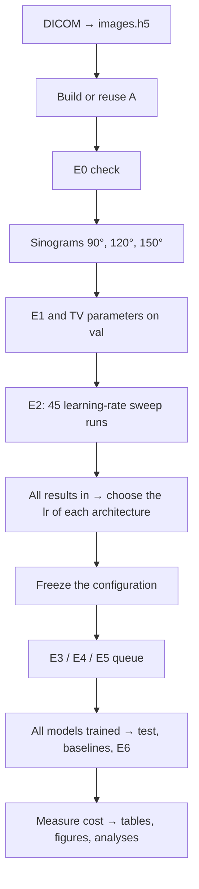

# The E0–E6 pipeline

Entry point: `lact pipeline run`. The command orchestrates the existing use cases and keeps the project's directory
layout.



## Files worth reading

| File | Responsibility |
|---|---|
| `src/lact/cli/commands/pipeline.py` | Parses the options and calls the pipeline |
| `src/lact/services/orchestration/pipeline.py` | Stage order, conditions for opening the next stage, saved progress |
| `src/lact/services/orchestration/stages.py` | Stage names, experiment names, the stage record and the configuration digest |
| `src/lact/services/scheduling/` | Expands the YAML grids into training runs (`jobs.py`), runs them (`runner.py`), orders the queue (`planning.py`) |
| `src/lact/infra/system/processes.py` | Keeps at most N processes, assigns a GPU to each job, deadline, forwards SIGTERM and waits for checkpoints |
| `src/lact/infra/system/gpus.py` | Reads nvidia-smi and picks idle GPUs by UUID (read-only, never occupies a GPU) |
| `src/lact/infra/system/locks.py` | Cache-writing locks between processes on the same machine |
| `src/lact/services/training/trainer/` | The training loop of one run and checkpoint resumption |
| `scripts/pack_source.py` | Packages the source as a ZIP to move it to a server |

## Running and resuming

```bash
# Set the data and cache paths in configs/local.yaml first.
lact pipeline run --device cuda
```

Run the same command again after the server/job stopped. `--until prepare`, `--until sweep` and `--until train` stop
at a milestone for inspection; the next call without `--until` continues. Steps that succeeded are not redone.
`--dry-run` only prints the plan; it does not check that the data/GPUs are ready.

Each stage records its state and the size/modification time of its outputs. A missing or changed file makes that
stage run again. Building A and simulating also check and reuse existing caches. The SHA-256 check before training is
still done by the manifest. If the local cache is lost, the pipeline rebuilds it from the original data files.

On a server, run inside `tmux` to keep the job alive when SSH disconnects (see the README). There is no time limit by
default. With `--max-hours`, the time counts from the pipeline call, preprocessing included; at the deadline a stop
signal is sent, then the pipeline waits for jobs to save their checkpoint (at most 600 seconds). After a server
restart, call the command again to continue.

## Parallel runs

**Several GPUs (recommended):** `--gpus` gives each process exactly ONE GPU through `CUDA_VISIBLE_DEVICES=<UUID>`
(inside the process that GPU is `cuda:0`). No GPU receives more than `--per-gpu` jobs (default 1).

```bash
lact pipeline run --gpus auto --n-gpus 2           # pick the 2 idlest GPUs (prints the status table first)
lact pipeline run --gpus 2 5                        # or give nvidia-smi indices / UUIDs
lact pipeline run --gpus all                        # every visible GPU (in a container that was given GPUs)
lact train grid configs/experiment/e3_main.yaml configs/experiment/e4_matched.yaml \
    configs/experiment/e5_a150.yaml --run --gpus auto   # run E3/E4/E5 by hand in one queue
```

`--gpus auto` only takes unused GPUs: used memory <= 1024 MiB (`--max-used-mb`), load <= 10% (`--max-util`, maximum
over 3 samples) and no compute process. With too few GPUs it fails and prints the table instead of taking busy GPUs
(`--allow-shared` relaxes this; not recommended on a shared server). GPUs are identified by UUID because the CUDA order
can differ from nvidia-smi's. Every GPU mode keeps the existing `CUDA_VISIBLE_DEVICES` restriction; an empty string
means no GPU may be used. Automatic selection skips GPUs without measurements or whose process list cannot be read.
With `--gpus`, `device` after merging the YAML files, `-s` and `--device` must be `auto`, `cuda` or `cuda:0`.

**What runs in parallel** (at most number of GPUs x `--per-gpu` processes at a time):

| Stage | Runs together | Waits for |
|---|---|---|
| prepare 1 | DICOM preprocessing ‖ building A (A only needs the geometry) | — |
| prepare 2 | E0 ‖ simulation 90°/120°/150° ‖ E1 | images + A |
| prepare 3 | TV tuning 90°/120°/150° | sinograms |
| sweep | the 45 E2 runs (15 models x 3 lr) | — |
| train | E3 + E4 + E5 in ONE queue, no barrier between them | the lr from E2 |
| finish 1 | test evaluation of the runs ‖ baselines ‖ E6 | — |
| finish 2 | cost measurement ALONE (inference time undisturbed by other jobs), then tables/figures | — |

Training queue order: unfinished runs first, then the **longest estimated runs first** (seconds/step of each
architecture measured in E2 x remaining steps). Long runs start early, so the two GPUs wait less for each other at the
end of the queue.

**One device:** without `--gpus` the previous behaviour applies: `--workers N` is the number of training processes on
the same `--device`. The number of processes is never guessed from VRAM. Each worker keeps its own model, optimizer
and sparse A on the GPU; two workers may be slower or run out of memory. RTX 2080 Ti 11 GiB: keep `--per-gpu 1`.

**Safety of parallel runs:**

- Each training run holds `.train.lock` in its directory: a second process training the same run (e.g. a job left
  over after losing SSH and calling the pipeline again, or a concurrent `train grid`) stops at once instead of
  overwriting checkpoints.
- The scheduler treats SIGHUP (lost SSH) like a stop request: it sends SIGTERM and waits for runs to save their
  checkpoints. Still run inside `tmux`.
- `manifest.json` and `eval/index.json` are updated under a lock; JSON files are written through per-process temporary
  files.
- Datasets share memory-mapped arrays on disk; a lock around cache building keeps a second worker from re-reading the
  whole HDF5 file.
- The locks are operating-system locks on one machine: they do not protect two servers/containers. Run only one
  pipeline per outputs directory.
- `summary.json` records `jobs_per_gpu`; the cost table has a "Lượt chung 1 GPU" column. A value > 1 means that run's
  training time was stretched by sharing the GPU and is not directly comparable with other runs.

## When something fails

- E0/E1 fail: the pipeline stops before E2. Look at `outputs/checks/` and fix the cause before running again.
- E2 incomplete / a DONE run without `best.pt`: no lr is chosen and E3/E4/E5 do not run.
- One E2 lr diverges: the other lr values are still tried. Each architecture needs at least one finite DONE result.
- OOM or a diverged E3/E4/E5 run: the error is recorded, the independent jobs of the queue finish, and evaluation is
  blocked. Reduce workers or change GPU after an OOM; check the run's `events.jsonl` and `summary.json`. To retry an
  OOM/DIVERGED run, delete exactly that `OOM`/`DIVERGED` marker file in its directory after fixing the cause. The latest
  checkpoint is still used to resume.
- Exit code 3: deliberate interruption / signal / deadline. Call the command again; it is not a completed run.
- Configuration differs from the saved one: the pipeline refuses to mix results. Restore the old configuration or use
  separate `paths.*` and `data.images_h5/stats_json/slices_json`. Never delete the state only to bypass the check.
- Evaluation interrupted while writing CSV/H5: a run without its completion mark in `index.json` is evaluated again.
  Runs whose results are complete are skipped.

The 10-minute checkpoint interval applies to the training loop and is checked after each batch; building one matrix
or simulating one geometry is still saved as a complete file, so a file in progress may have to be redone.

## Data variants and grid extensions

- **Data variants** (`-c configs/variant/<name>.yaml`): the same workflow on other measured data (Mayo + Poisson noise,
  DeepLesion). Each variant has its own `paths.outputs`, manifest, pipeline state (`<outputs>/pipeline/main.json`) and
  `cache.dir`; the projection matrices (`paths.operators`) are shared. Noise variants reuse the original `images.h5`:
  simulation also records that file in the variant's manifest so training can check its SHA-256. Never point two
  variants at the same `cache.dir`: the sinogram copies have the same file names.
- **Grid extension** (`--extend`): for E2–E5 grids that gained runs (new architectures) on finished outputs. The old
  fingerprint is saved in `previous_fingerprints`; each old run must still match its saved `config.yaml` (otherwise
  "configuration changed"), and data/matrices are still compared with their metadata. The cost measurement runs again
  when the set of runs changes; tables/figures/analyses run again when `eval/index.json` or the cost table changes.
- Configuration merge order: defaults → `configs/local.yaml` → the `-c` files → `-s`. Put variant files after the
  environment file (e.g. `-c configs/env/server.yaml configs/variant/mayo_poisson_1e6.yaml`).
- **Choosing models** (`--models <arch> ...`): every E2–E5 grid keeps only the runs whose `model.arch` is in the list;
  the lr is chosen (and required) only for those models. The list is part of the fingerprint: resuming needs the same
  list; to add models to existing outputs, drop `--models` (or change the list) and add `--extend`.
- **Moving runs to another machine** (`lact eval recheck`): the matrices A and the sinograms are rebuilt on the new
  machine, so before training more, the `best` checkpoint of a few old runs is re-evaluated on the validation split and
  compared with the recorded `best_val_psnr` (tolerance 0.02 dB). `scripts/vast/full.sh` runs this right after
  `prepare`. GPU-hours still to train: `lact train plan --pilot <csv from lact train pilot>`. On rented machines:
  [VAST.md](VAST.md).
